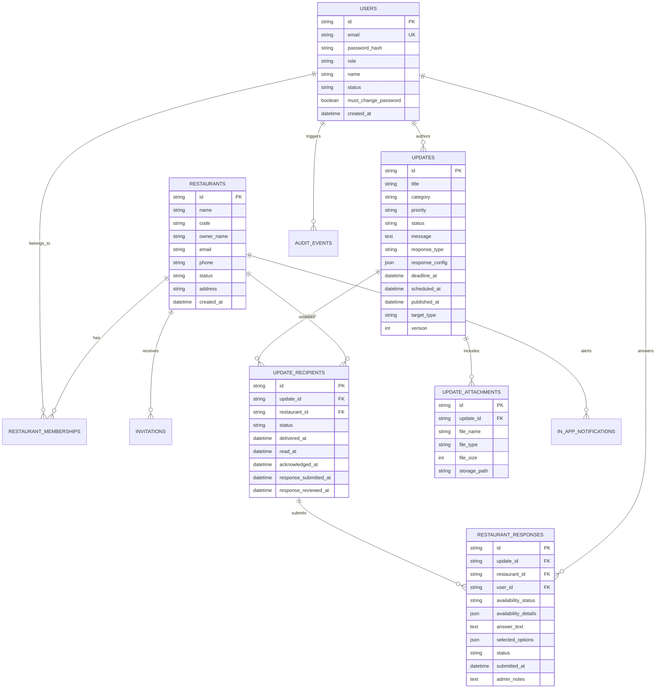

# Daily Drop Restaurant Partner System Architecture & Specifications

## 1. Executive Summary & Brand Identity
Daily Drop is an established food pre-order and delivery platform. This project implements the **Restaurant Partner Management & Update Communication Application** composed of:
1. **Daily Drop Admin Portal (React Web)**: For Daily Drop operations to manage restaurants, author/publish targeted operational updates, manage attachments, and track restaurant delivery/read/acknowledgement/response metrics in real time.
2. **Restaurant Partner Mobile App (React Native)**: For restaurant owners and kitchen managers to receive urgent operational updates, read instructions, download private attachments, acknowledge requirements, submit availability confirmations, and communicate issues.
3. **Daily Drop Core REST API & Backend Service (Node.js + Express + TypeScript)**: Unified multi-tenant backend enforcing strict restaurant data isolation, role-based authorization, token security, and audit logging.

### Design Tokens (Daily Drop Design System)
Extracted directly from the official Daily Drop asset repository:
- **Brand Forest Green (Primary)**: `#264329`
- **Brand Forest Dark**: `#182E1B`
- **Brand Forest Light**: `#365D3B`
- **Brand Orange (Accent / Warning / Pending)**: `#ED8533`
- **Brand Orange Hover**: `#DA7424`
- **Brand Orange Light**: `#FDF3EB`
- **Brand Mint (Subtle green surfaces)**: `#EBF5EE`
- **Brand Mint Subtle**: `#F4FAF6`
- **Brand Mint Border**: `#D8E5DC`
- **Brand Cream (Background)**: `#FAFCF9`
- **Brand Dark (Typography)**: `#152217`
- **Brand Muted (Secondary text)**: `#5A6E5E`
- **Brand Urgent Red**: `#DC2626` / Light: `#FEF2F2`
- **Brand High Amber**: `#D97706` / Light: `#FEF3C7`
- **Typography**: Plus Jakarta Sans, Inter, sans-serif

---

## 2. Monorepo Project Structure
```
DD Resto app/
├── apps/
│   ├── api/              # Node.js + Express + TypeScript REST API
│   │   ├── src/
│   │   │   ├── config/       # Environment & security config
│   │   │   ├── db/           # SQLite / PostgreSQL driver & migrations
│   │   │   ├── middleware/   # Auth, roles, error handlers, upload
│   │   │   ├── routes/       # Auth, restaurants, updates, responses, notifications
│   │   │   ├── services/     # Email, notification, file storage, scheduler
│   │   │   └── index.ts      # Server entrypoint
│   │   └── package.json
│   ├── admin/            # Daily Drop Admin Portal (React + Vite + TS)
│   │   ├── src/
│   │   │   ├── assets/       # Daily Drop logo and icons
│   │   │   ├── components/   # Modern, responsive UI components
│   │   │   ├── pages/        # Dashboard, Restaurants, Updates, Tracking
│   │   │   ├── services/     # Typed API client
│   │   │   └── App.tsx
│   │   └── package.json
│   └── mobile/           # Restaurant Partner Mobile App (React Native + TS)
│       ├── src/
│       │   ├── assets/       # Brand logos & splash visuals
│       │   ├── components/   # Safe touch targets, cards, badges, modals
│       │   ├── screens/      # Splash, Login, Dashboard, Updates, Detail, Responses, Profile
│       │   ├── navigation/   # Native Stack & Bottom Tabs
│       │   ├── services/     # Secure storage & API client
│       │   └── theme/        # Daily Drop mobile styling tokens
│       └── package.json
├── packages/
│   └── shared/           # Shared types, Zod schemas, status enums
│       ├── src/
│       │   ├── types.ts
│       │   └── constants.ts
│       └── package.json
├── docs/                 # API documentation & deployment guide
├── sample_attachments/   # Test spreadsheets, menus, schedules
└── package.json          # Root workspace configuration
```

---

## 3. Data Model & Entity Relationship



---

## 4. API Endpoints Contract (/api/v1)

### Authentication
- `POST /api/v1/auth/login`: Email/password login with JWT token & user profile
- `POST /api/v1/auth/accept-invitation`: Set password with single-use token
- `POST /api/v1/auth/forgot-password`: Request password reset email
- `POST /api/v1/auth/reset-password`: Complete password reset
- `POST /api/v1/auth/change-password`: Authenticated password change
- `GET /api/v1/auth/me`: Current session & permissions

### Admin Management
- `GET /api/v1/admin/dashboard/metrics`: Real-time restaurant, update & response KPIs
- `GET /api/v1/admin/restaurants`: Searchable list of restaurants with status & pending counts
- `POST /api/v1/admin/restaurants`: Create new restaurant partner
- `PUT /api/v1/admin/restaurants/:id`: Update restaurant details
- `POST /api/v1/admin/restaurants/:id/invite`: Send or resend invitation link
- `PATCH /api/v1/admin/restaurants/:id/status`: Suspend or reactivate restaurant

### Updates & Distribution
- `GET /api/v1/admin/updates`: Filterable updates list (Draft, Scheduled, Published, Archived)
- `POST /api/v1/admin/updates`: Create update (draft, schedule, or immediate publish)
- `GET /api/v1/admin/updates/:id`: Update details with full targeting & response tracking metrics
- `PUT /api/v1/admin/updates/:id`: Edit update (version bump & recipient notification)
- `POST /api/v1/admin/updates/:id/publish`: Publish scheduled or draft update
- `POST /api/v1/admin/updates/:id/archive`: Archive update
- `POST /api/v1/admin/updates/:id/attachments`: Upload private attachments
- `GET /api/v1/admin/updates/:id/tracking`: Granular per-restaurant response matrix
- `PATCH /api/v1/admin/updates/:id/responses/:responseId/review`: Admin note & status review

### Restaurant Partner Mobile Endpoints
- `GET /api/v1/restaurant/dashboard`: Mobile home feed with urgent alerts, pending actions & categories
- `GET /api/v1/restaurant/updates`: Filterable updates feed (All, Unread, Urgent, Awaiting Response, Overdue)
- `GET /api/v1/restaurant/updates/:id`: Detail view (triggers automatic 'read' tracking)
- `GET /api/v1/restaurant/updates/:id/attachments/:attachmentId/download`: Authorized private file stream
- `POST /api/v1/restaurant/updates/:id/acknowledge`: Acknowledge update
- `POST /api/v1/restaurant/updates/:id/response`: Submit availability / answers / notes / constraints
- `GET /api/v1/restaurant/responses`: Restaurant's submitted response history
- `GET /api/v1/restaurant/notifications`: In-app notification center
- `PATCH /api/v1/restaurant/notifications/:id/read`: Mark notification read
